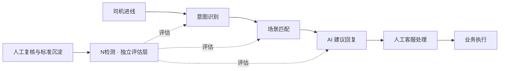

# N检测业务需求与评估标准 V1.1

| 项    | 内容                                                                    |
| ---- | --------------------------------------------------------------------- |
| 文档定位 | 业务需求定义 / 检测标准 / 人工标注治理                                                |
| 当前状态 | 三轮需求确认完成，待业务评审                                                        |
| 建设范围 | 客服业务内部，优先支持批量离线检测与单条人工复核                                              |
| 版本说明 | V1.1 = V1.0 评审稿基线 + 定位表达、术语表、扩展示例、决策溯源补充；新增内容以【V1.1 补充】标注，V1.0 正文保持原意 |
| 不涉及  | 模型选型、技术架构、开发方案                                                        |

---

# 第 0 章 定位、边界与命名（V1.1 新增）

## 0.1 一句话定位

N检测（命名待定，建议见 0.5）是**面向客服 AI 决策链路的独立质量评估能力**：以原始客服会话为唯一事实输入，独立还原司机真实诉求，分环节验证意图识别、场景匹配与 AI 建议回复的准确性与有效性；证据充分时给出可追溯到会话证据或业务标准的判断，证据不足时明确拒判；并通过人工复核、争议裁决与标准沉淀，形成"检测 → 复核 → 裁决 → 标准 → 复评"的闭环，持续产出可信的评估标准、基准样本与业务质量结论。

三个定位维度：

- **对谁**：客服业务负责人，以及意图识别、场景匹配、AI 辅助回复各项 AI 能力的建设方。
- **解决什么**：回答"AI 决策链路对不对、错在哪、凭什么判、判不了怎么办"。
- **凭什么**：原始会话事实 + 有效业务标准 + 人工确认结论。三者缺一，结论即降级为"无法判断"。

## 0.2 它是什么 / 它不是什么

| 它是                             | 它不是                       |
| ------------------------------ | ------------------------- |
| 独立评估层：不复用被检测系统的结论作为答案          | 又一个意图识别或场景匹配模型            |
| AI 决策链路的分环节质检（诉求→意图→场景→回复逐层判断） | 客服问题真实解决率的核验（一期明确不做）      |
| 规模化初筛 + 人工裁决闭环                 | 人工抽检的替代品                  |
| 业务标准缺陷的发现装置（"无法判断"= 治理输入）      | 线上规则的自动修改者（一期只检测与反馈，不改线上） |
| 可解释的判定体系（每个结论可追溯）              | 黑盒打分器（不输出无依据的分数）          |
| 可持续运营的标准库与样本库                  | 一次性项目交付的报告工具              |

## 0.3 在客服 AI 业务链路中的位置



定位说明：

1. N检测横切在**意图识别、场景匹配、AI 建议回复**三个环节之上，作为旁观者独立评估，不介入、不修改线上（一期）。
2. **人工客服处理与业务执行两个环节一期不评价**——那需要人工采纳记录和实际业务状态数据，超出当前范围（见 1.3）。
3. 人工复核与标准沉淀是 N检测的回流来源：没有这一环，检测标准会停滞，误判会固化。

## 0.4 与现有指标的关系

| 现有指标      | 能回答           | 不能回答                   | N检测的补充                                         |
| --------- | ------------- | ---------------------- | ---------------------------------------------- |
| 意图识别率     | 系统在自测集上的命中表现  | 命中是否真实正确（测试集与标注可能同源偏差） | 以原始会话独立还原诉求后对比，输出识别错误 / 识别遗漏 / 体系缺失 / 标准不明四类细分 |
| 响应效率 / 时效 | 回得多快          | 答得对不对、全不全              | 分环节准确性 + 完整性 + 风险性                             |
| 满意度 / 投诉率 | 司机整体感受（滞后、聚合） | 感受背后具体错在哪个环节           | 错误归因到意图 / 场景 / 回复 / 标准 / 数据五类责任域               |

结论：现有指标回答"快不快、多不多"，N检测回答"对不对、错在哪、凭什么"——两者互补，不可互相替代。

## 0.5 命名建议（待拍板）

"N检测"为内部讨论曾用名，正式命名需体现**纠错纠偏**含义。三个候选：

| 候选 | 代号      | 含义                                             | 评估                       |
| -- | ------- | ---------------------------------------------- | ------------------------ |
| 校准 | Calibra | 计量学原义：对照标准器、把偏差纠正归位；同时覆盖"纠错"（发现偏差）与"纠偏"（拉回标准线） | **推荐**：与系统动作完全同构         |
| 校正 | Rectif  | 直白强调纠错                                         | 通用词，易与日常用语混淆；弱"对照标准"的测量感 |
| 真值 | Veritas | 强调判定真伪                                         | 纠偏动作感弱，且易与"意图准确性"混淆      |

决策建议：若业务侧无强偏好，建议采&#x7528;**「校准（Calibra）」**，文档、看板与对外表述统一主称，"N检测"作为曾用名在术语表（附录 A）备注。**此事项待业务负责人拍板（见第十四章遗留事项 1）。**

## 0.6 读者指南

| 读者          | 重点章节          | 使用方式           |
| ----------- | ------------- | -------------- |
| 业务负责人       | 第 0、一、九、十、十二章 | 判断建设范围、验收标准与风险 |
| 业务规则负责人     | 第三、五、七章、附录 B  | 维护标准、裁决冲突      |
| 人工标注人员      | 第四、六、七章、附录 A  | 判定与复核操作        |
| 产品 / PRD 编写 | 全文            | 派生功能需求与原型方案    |
| Agent 能力设计  | 第三、四、六章       | 检测规则、拒判逻辑与输出结构 |
| 数据分析        | 第八章           | 指标口径与分析维度      |

---

# 一、业务背景与核心目标

## 1.1 业务背景

当前司机客服业务已经具备意图识别、场景匹配、AI 辅助回复等能力，但缺乏对整条 AI 决策链路的独立评估机制。

目前主要存在四类问题：

| 问题          | 当前表现                           | 业务影响                 |
| ----------- | ------------------------------ | -------------------- |
| 识别效果不可验证    | 系统能够输出意图，但缺乏独立判断其准确性的机制        | 无法识别错误意图与遗漏诉求        |
| 场景匹配质量不清晰   | 能够获取命中的场景 ID，但无法判断是否应该命中该场景    | 无法区分意图错误和场景匹配错误      |
| AI 回复效果不可量化 | AI 能够提供客服辅助建议，但不知道建议是否正确、完整、有效 | 难以判断 AI 建议是否具有实际业务价值 |
| 业务标准不完整     | 意图、场景和回复规则可能存在缺失或边界不清晰         | 评价缺少依据，问题无法有效归因      |

现有的意图识别率、响应效率等指标无法完整反映上述问题。

## 1.2 核心目标

建立 N检测能力，以原始客服会话为事实输入，独立识别司机真实诉求，对意图识别、场景匹配、AI 建议回复进行准确性与有效性检测，并通过人工复核建立可信的评估标准和数据分析体系。

核心解决三个业务问题：

1. **准确性评估：** 已有意图、场景及 AI 回复到底是否正确？
2. **错误归因：** 如果不正确，错误发生在哪里，属于哪类问题？
3. **标准治理：** 如果无法判断，是因为缺少对话证据，还是业务标准本身不完整？

最终形成从原始会话到问题定位、人工裁决、标准沉淀和效果量化的闭环。

【V1.1 补充】三个业务问题的递进关系：三个问题不是并列清单，而是一条递进链——准确性评估回答"对不对"（检测），错误归因回答"错在哪"（定位），标准治理回答"凭什么判、判不了怎么办"（依据）。缺少第三步，前两步的结论会退化为模型自说自话。因此"无法判断"不是系统的失败输出，而是标准治理的输入，这是全套设计的世界观起点。

## 1.3 业务边界

N检测第一阶段评价的是**AI 决策质量和建议有效性**，不是司机问题的真实解决结果。

必须区分：

| 概念         | 含义                  | 一期是否评价   |
| ---------- | ------------------- | -------- |
| 意图正确       | 系统是否理解司机真实诉求        | 是        |
| 场景正确       | 是否匹配正确场景分类或 ID      | 是        |
| AI 建议有效    | AI 建议是否正确、完整并具备处理价值 | 是        |
| 客服是否采纳建议   | 人工客服是否使用 AI 提供的建议   | 否        |
| 客服是否实际处理成功 | 客服是否完成必要的业务操作       | 否        |
| 司机问题是否真实解决 | 实际业务状态是否满足司机诉求      | 暂不作为核心评价 |

**约束：不能将 AI 建议有效率直接等同于客服问题解决率。**

---

# 二、检测对象和业务范围

## 2.1 基础检测单元

采用三级结构：

**第一级：会话**

一条司机与客服的完整沟通记录，作为上下文分析基础。

**第二级：诉求**

从完整会话中提取一个或多个具体诉求，区分主诉求和次诉求。

**第三级：检测结果**

针对每个诉求分别评估意图识别、场景匹配和 AI 建议回复。

例如：

司机同时咨询奖励未到账、奖励金额异常时，需要分别保留两项诉求的判断结果，不能只输出一个总意图。

主次诉求划分原则：

- 主诉求：本次沟通中最核心、最需要解决的问题。
- 次诉求：同时提出且具有独立处理需求的其他问题。
- 重复表达同一问题，不重复计算诉求数量。
- 同一问题的原因补充、条件说明、追问，不一定构成新的诉求。
- 无法确定主次关系时，记录为待确认，不能任意指定。

**重要边界：** 如果被检测的原系统只支持输出一个意图，则应分别评价主意图准确性与次诉求覆盖情况。次诉求未覆盖应记录为能力覆盖问题，不能在未确认原系统设计要求的情况下直接判定为模型识别错误。

【V1.1 补充】为什么用三级结构：三个层级各自承担不可互相替代的职责——会话是上下文单元（诉求的判断依赖完整对话，司机可能在第三轮才补充关键条件）；诉求是归因单元（错误必须落到具体诉求上才能归因，会话级一个总意图会掩盖次诉求遗漏）；检测结果是评价单元（每个诉求独立输出意图/场景/回复三层结论，才能支撑 4.3 的汇总规则与第八章的分维度统计）。

主次诉求划分的三个实操难点提示：

1. **追问 vs 新诉求**："那这个多少钱"可能是对同一问题的补充，不构成新诉求；"另外我的另一个奖励也不对"则是。
2. **情绪表达 vs 诉求**：抱怨通常是诉求的伴生现象，不单列为诉求，但应作为证据保留。
3. **复合诉求的拆分粒度**："奖励没到账且金额不对"是两个可独立处理的诉求，应拆分（参照 6.1 示例）；"奖励没到账"与"奖励什么时候到账"是同一诉求的不同表达，不拆分。

## 2.2 输入范围

| 输入对象    | 信息内容                  | 用途         |
| ------- | --------------------- | ---------- |
| 原始文本会话  | 司机与客服的完整沟通内容、角色、消息顺序  | 还原真实诉求     |
| 语音转写文本  | 通话转写后的文本及可用的说话人标识     | 作为会话评估输入   |
| 系统意图结果  | 意图名称、意图 ID、识别结果       | 对比实际诉求     |
| 命中场景信息  | 场景 ID、场景名称及可用的关联信息    | 判断场景选择是否合理 |
| AI 建议回复 | 提供给人工客服参考的建议内容        | 评估建议质量     |
| 业务标准    | 意图定义、场景定义、映射关系及现有业务规则 | 形成判断依据     |

支持两种基本使用方式：

- 批量导入会话及相关检测材料，输出逐条结果和整体统计。
- 输入单条会话，查看完整判断依据并进行人工复核。

单条或批量输入允许部分参考数据缺失，但应明确记录字段缺失，并对受影响的检测维度标记无法判断，不能补造原系统结果。

第一阶段暂不评价语音转写准确率，因为只有转写文本、没有原始音频时，无法独立验证识别是否准确。

【V1.1 补充】部分字段缺失的处理哲学：允许缺失，但处理方式必须是"标记 + 降级判定"，而不是"补造 + 照常判定"：

- 缺失原意图 → 意图检测维度标记 U09，其余维度不受影响；
- 缺失场景定义 → 场景检测标记 U02，不得以"场景名称与意图名称相似"代替判定；
- 缺失 AI 建议 → 回复检测按"本应产生建议"与否标记 U09 或不适用；
- 缺失转写关键消息 → 涉及诉求还原的维度标记 U06。

原则一句话：**材料给什么判什么，材料没什么标什么，绝不替被检测系统编结果。**

---

# 三、检测标准体系

## 3.1 检测总原则

所有判断遵守四项原则：

**原则一：独立评估。** 不能把现有 AI 的意图、场景或回复直接当作正确答案。

**原则二：逐层判断。** 意图、场景、回复分别评价，不因上一环节正确就默认下一环节正确。

**原则三：证据约束。** 每一个正确或错误结论必须具有足够依据，不能仅依据模型主观推测。

**原则四：标准不足不强判。** 当缺少必要标准或证据时，结果必须标记为无法判断。

【V1.1 补充】四项原则的相互关系：独立评估是**立场**（防止"用被评估者的结论验证自己"的循环论证）；逐层判断是**方法**（防止"上游对 = 全对"的连带正确假设）；证据约束是**依据**（每个结论必须能指认会话原文或标准条款）；不强判是**底线**（前三项都做不到时，唯一合法的输出是"无法判断 + 原因"）。立场决定视角，方法决定粒度，依据决定可信度，底线决定边界。任一原则被破坏，检测结论即失去业务可用性。

## 3.2 意图识别检测

| 检测项    | 判断依据         | 典型问题               |
| ------ | ------------ | ------------------ |
| 真实诉求还原 | 原始会话完整上下文    | 把抱怨、原因说明当成真正诉求     |
| 主意图准确性 | 真实主诉求与意图定义   | 司机咨询奖励未到账，却识别为奖励风控 |
| 次诉求覆盖  | 是否遗漏独立的次要诉求  | 同时提出到账与金额异常，只识别到账  |
| 意图边界   | 意图定义、包含与排除条件 | 两个意图定义重叠，无法明确区分    |
| 意图体系覆盖 | 是否存在对应的有效意图  | 司机诉求未被现有意图体系覆盖     |

判定时应区分：

- **识别错误：** 已有明确适用意图，但系统命中了其他意图。
- **识别遗漏：** 应覆盖的独立诉求没有被识别。
- **体系缺失：** 现有意图体系不存在适用标签。
- **标准不明：** 无法确认不同意图的适用边界。

没有意图定义及边界标准时，可以根据会话还原司机诉求，但不能仅凭标签字面意思就正式判定意图 ID 的准确性。

## 3.3 场景匹配检测

场景定义为意图识别后命中的业务场景分类或场景 ID。

不包含场景内具体 SOP 的执行正确性。

| 检测项    | 判断依据           | 典型问题         |
| ------ | -------------- | ------------ |
| 场景匹配准确 | 实际诉求与场景定义      | 诉求与命中场景不符    |
| 意图场景关联 | 意图和场景的有效映射规则   | 意图正确但匹配错误场景  |
| 场景边界   | 场景适用与排除条件      | 多个场景分类重叠     |
| 场景覆盖   | 现有场景体系是否能覆盖该诉求 | 没有适合的处理场景    |
| 上游错误影响 | 意图错误与场景错误的关联证据 | 错误意图导致后续路由异常 |

必须区分两种判断：

**独立场景正确性：** 不考虑系统原本识别的意图，直接根据司机真实诉求判断最终命中场景是否正确。

**条件场景正确性：** 在意图识别正确的前提下，判断后续场景匹配是否正确。

如果缺少场景定义或映射关系，不能仅因为场景名称与意图名称相似就判定匹配正确。

【V1.1 补充】独立/条件场景正确性的判读路径：

- 第一步（独立判断）：抛开原系统识别的意图，仅根据还原出的真实诉求，判断它**理应**命中什么场景——得到"独立场景正确性"。
- 第二步（条件判断）：假设原意图是正确的，判断从该意图到实际命中场景的映射是否合理——得到"条件场景正确性"。

两种结论的组合含义：

| 独立   | 条件 | 解读                              |
| ---- | -- | ------------------------------- |
| 正确   | 正确 | 场景环节无问题                         |
| 错误   | 正确 | 映射本身合理，但上游意图错误把流量引到了错误场景——根因偏上游 |
| 错误   | 错误 | 场景匹配环节自身存在问题（映射规则错或场景选择错）       |
| 无法判断 | 可判 | 标准缺失发生在独立判断侧                    |

两个结论都记录，用于第五章的根因拆分，避免把所有场景错误都记在意图头上。

## 3.4 AI 建议回复检测

AI 回复仅作为提供给人工客服的辅助建议进行评价。

| 维度   | 评估问题                 | 错误表现             |
| ---- | -------------------- | ---------------- |
| 相关性  | 是否真正回应司机当前问题         | 答非所问、偏离诉求        |
| 正确性  | 是否符合已知业务事实和有效规则      | 错误解释、错误承诺        |
| 完整性  | 是否覆盖必要诉求、前提和关键步骤     | 漏答、遗漏重要条件        |
| 可执行性 | 客服或司机能否按建议进行下一步处理    | 提供不存在或不可执行的操作    |
| 风险性  | 是否存在可能损害司机权益或误导客服的内容 | 错误判责、金额错误、虚假时效承诺 |

其中需要进一步区分：

- **建议相关：** 语言上回应了问题。
- **建议正确：** 内容与已知事实及业务规则一致。
- **建议有效：** 正确且完整，能够提供与当前诉求相适配的解释或处理路径。
- **问题已解决：** 需要额外实际处理证据，不属于当前 AI 回复评价结论。

建议有效性不是单独依据语言质量打分，而是由相关性、正确性、完整性、可执行性和必要风险检查综合构成。

只要关键维度存在明确错误，整体建议就不能判定为有效；如果不存在已确认错误，但关键维度无法判断，则整体建议同样不能判定为有效。

【V1.1 补充】五个维度的逻辑关系：

- **相关性是门槛**：答非所问则后续维度失去评价基础（但各维度仍分别记录结论，不自动连带）。
- **正确性是底线**：与已知业务事实/规则冲突即明确错误。
- **完整性看覆盖**：必要诉求、前提、关键步骤的遗漏检测（6.1 示例的核心）。
- **可执行性看落地**：建议中的操作是否真实存在、可执行。
- **风险性是否决项**：错误判责、金额错误、虚假时效承诺等高风险内容一票否决整体有效性。

组合规则的认识论核心：**"没有发现错误"与"没有错误"是两件事**——关键维度存在明确错误，整体不通过；无已确认错误但关键维度无法判断，整体同样不通过。有效性结论只向前者倾斜，不向"没查出问题"倾斜。

---

# 四、检测结果标准

## 4.1 统一判定结果

| 结果   | 定义                 | 判定条件           |
| ---- | ------------------ | -------------- |
| 正确   | 检测对象符合当前有效标准       | 存在充分的正向判断证据    |
| 错误   | 检测对象明确不符合标准或可验证事实  | 能够指出具体偏差和支持证据  |
| 无法判断 | 缺少充分证据，不能可靠判断正确或错误 | 信息不足、标准缺失或标准冲突 |
| 不适用  | 当前业务确实不存在该评价对象     | 例如该场景下本来无需生成回复 |

**第三轮已确认约束：缺少必要业务标准时，标记为「无法判断」，不能由 Agent 自行补充规则并生成正式判定。**

需要注意：

1. 标准缺失不是错误结论，而是无法判断的原因。
2. 不能因为没有发现错误，就判定结果正确。
3. 原始材料本应提供但实际缺失，应标记无法判断，不应直接视为不适用。
4. 不同维度可以独立得出不同结果。例如回复相关性错误，但业务规则正确性无法判断。
5. AI 可以客观记录已观察到的异常现象，但不能在缺少依据时输出确定性的正确答案或修正后的正式标准。

【V1.1 补充】四态判定的决策路径：

```
评价对象是否存在？——否 → 不适用
存在充分正向证据（符合标准/事实）？——是 → 正确
存在明确反向证据（能指出具体偏差）？——是 → 错误
以上皆非（信息不足 / 标准缺失 / 标准冲突）→ 无法判断（必须带 U 码）
```

配套纪律：①"没有发现错误"不等于"正确"——正确需要正向证据；②"没有发现错误"也不等于"错误"——错误需要反向证据；③无法判断必须带原因分类（4.2），不允许输出裸的"无法判断"。

## 4.2 无法判断的原因分类

| 原因代码 | 原因       | 示例                  |
| ---- | -------- | ------------------- |
| U01  | 意图标准缺失   | 没有意图 ID 的定义及适用边界    |
| U02  | 场景标准缺失   | 没有场景 ID 对应的场景定义     |
| U03  | 关联规则缺失   | 缺少意图与场景的匹配关系        |
| U04  | 回复业务规则缺失 | 无法确认到账时间、奖励计算或处理规则  |
| U05  | 标准冲突     | 两项有效标准给出不同要求        |
| U06  | 对话证据不足   | 会话截断、关键消息缺失         |
| U07  | 转写内容不明确  | 语音转写语义不通或无法确定说话人    |
| U08  | 业务条件不足   | 缺少决定处理方案是否适用的必要条件   |
| U09  | 检测对象信息缺失 | 缺少应有的意图、场景或 AI 建议记录 |

每条无法判断记录至少需要保留：

- 无法判断的具体检测项。
- 原因分类。
- 缺少什么依据或材料。
- 需要由谁补齐或确认。

【V1.1 补充】无法判断是治理输入，不是失败：每个 U 码对应一类待办事项，直接进入第七章第五步"标准沉淀"与治理清单：

- U01 / U02 / U03 / U04 → 业务规则负责人补定义、补映射；
- U05 → 业务裁决（冲突仲裁）；
- U06 / U07 → 数据质量反馈（上游修复）；
- U08 → 明确业务条件采集要求；
- U09 → 明确检测对象的信息完整性要求。

因此第八章必须把"无法判断率 / 标准缺失占比"与准确率并列披露——它衡量的是评价体系的成熟度，而不是检测器的质量。

## 4.3 整体结果汇总规则

**诉求级：**

- 所有适用的关键检测项均正确，且不存在无法判断，才可判定该诉求决策链路通过。
- 任一关键检测项错误，则链路未通过。
- 没有已确认错误，但存在关键项无法判断，则整体无法判断。

**会话级：**

- 保留所有主次诉求的独立结果。
- 全部适用诉求通过，才可认定该会话检测通过。
- 存在错误则标记存在已确认问题。
- 无错误但仍有无法判断项目，应标记整体无法判断。

不能使用简单平均分掩盖关键错误或未知项。

---

# 五、问题分类与归因标准

## 5.1 问题分类

| 一级分类    | 二级原因                    | 主要责任领域    |
| ------- | ----------------------- | --------- |
| 意图识别问题  | 理解偏差、意图错配、诉求遗漏          | 意图识别能力    |
| 意图标准问题  | 定义模糊、边界冲突、标签缺失          | 意图体系      |
| 场景匹配问题  | 场景错配、关联关系错误             | 场景匹配规则    |
| 场景标准问题  | 场景缺失、场景重复、定义冲突          | 场景体系      |
| AI 回复问题 | 答非所问、内容错误、遗漏、不可执行、风险性回复 | AI 辅助回复能力 |
| 数据质量问题  | 会话截断、说话人混淆、转写异常         | 原始数据质量    |
| 评价标准问题  | 规则缺失、规则冲突、版本不明          | 业务标准治理    |

## 5.2 错误归因原则

必须区分：

**直接错误：** 当前环节存在的客观错误。

**根因：** 有证据证明导致错误产生的主要原因。

**连锁影响：** 上游错误可能导致的后续错误表现。

例如：

司机咨询奖励未到账，系统错误识别成奖励风控，场景命中风控咨询，AI 回复解释了风控规则。

结果可以是：

- 意图识别：错误。
- 场景匹配：错误。
- AI 回复相关性：错误。
- 可能根因：意图识别偏差。
- 后续影响：场景及回复偏离司机原始诉求。

但在没有进一步证据时，不应直接判定所有错误都必然由意图识别造成。

对于根因可以设置：

- 已确认：有明确证据支持因果关系。
- 待确认：存在合理关联，但无法证明。
- 无法归因：现有数据不足。

同一条会话允许存在多个直接错误，但统计根因时需要去重，不能把一次连锁异常当成多个相互独立的根因。

【V1.1 补充】根因三级置信度的使用规则：

- **已确认**：必须能描述完整的因果链条证据（如"意图错误 → 路由到风控场景 → 回复解释风控规则"，每一步都有记录支撑）。
- **待确认**：存在合理关联但缺一环证据——保留为待确认，进入人工复核优先级（7.2），不得写入统计的根因分布。
- **无法归因**：证据不足以下任何结论——记录现象，不强行归因。


统计口径：直接错误可以多发；根因统计必须去重（一次连锁异常只计一个根因）；待确认与无法归因不计入"已确认根因"的分母。

---

# 六、单条检测结果定义

每条检测结果至少需要覆盖以下信息：

| 模块   | 输出字段           | 说明          |
| ---- | -------------- | ----------- |
| 基础信息 | 会话 ID、来源、时间    | 用于追溯原始样本    |
| 诉求还原 | 主诉求、次诉求、证据原文   | 明确司机真正提出的问题 |
| 原始识别 | 原意图名称及 ID      | 保留被检测系统结果   |
| 意图检测 | 检测结论、错误类型、原因   | 判断意图识别质量    |
| 场景检测 | 原场景 ID、检测结论、原因 | 判断场景匹配质量    |
| 回复检测 | AI 建议原文、各维度结论  | 判断建议有效性     |
| 问题归因 | 直接错误、可能根因、关联影响 | 支持定位问题      |
| 判断依据 | 会话证据、适用标准及版本   | 保证结论可复核     |
| 不确定性 | 无法判断原因、缺失条件    | 防止强行得出结论    |
| 人工标注 | 复核状态、人工结论、修正原因 | 沉淀最终可信结果    |

## 6.1 示例：多诉求会话检测

**模拟原始会话**

司机：「上周的保底奖励还没有到账，而且显示的金额少了 30 元。」

系统识别意图：「保底奖励未到账」。

场景命中：「奖励到账咨询」。

AI 建议：「奖励一般在三个工作日内到账，请您耐心等待。」

在当前尚未提供完整意图、场景及奖励规则的情况下：

| 检测项      | 结果      | 依据                             |
| -------- | ------- | ------------------------------ |
| 主诉求提取    | 奖励未到账   | 司机明确表达                         |
| 次诉求提取    | 奖励金额异常  | 司机明确表达少了 30 元                  |
| 主意图标签准确性 | 无法判断    | 尚缺意图定义与边界标准                    |
| 次诉求覆盖    | 存在未覆盖现象 | 当前记录只有到账意图；是否构成识别错误，取决于原系统覆盖要求 |
| 场景准确性    | 无法判断    | 缺少场景定义及关联规则                    |
| 回复相关性    | 部分相关    | 提到了到账，但没有涉及金额异常                |
| 回复完整性    | 错误      | 未回应已明确提出的金额差异问题                |
| 回复规则正确性  | 无法判断    | 不知道三个工作日是否符合实际规则               |
| 建议整体有效性  | 不通过     | 已确认遗漏一项独立诉求                    |

该案例能够发现 AI 回复中的明确遗漏，但不能在没有标准的情况下推断到账规则和场景分类一定错误。

## 6.2 扩展示例 A：标准冲突（V1.1 新增）

**模拟场景**

司机问"奖励几个工作日到账"。有效规则 A（常规规则）写"3 个工作日内"；有效规则 B（活动规则）写"活动期间 2 个工作日内"，但未规定冲突时的适用优先级。AI 建议引用 3 个工作日。

| 检测项     | 结果        | 依据                   |
| ------- | --------- | -------------------- |
| 回复相关性   | 正确        | 回应了到账时间问题            |
| 回复规则正确性 | 无法判断（U05） | 两项有效标准给出不同要求，且无优先级规则 |
| 建议整体有效性 | 无法判断      | 关键维度无法判断             |
| 派生事项    | 标准待完善     | 需业务裁决冲突时的适用规则        |

要点：**不得任选一项标准、把另一项判为错误**——标准冲突的出路是裁决，不是投票。

## 6.3 扩展示例 B：高风险回复，风险性一票否决（V1.1 新增）

**模拟场景**

AI 建议：「您未在高峰时段出车，保底奖励已取消。」而会话中司机表示"高峰时段平台未派单所以无法出车"。

| 检测项     | 结果                 | 依据                            |
| ------- | ------------------ | ----------------------------- |
| 回复相关性   | 正确                 | 回应了奖励取消原因                     |
| 回复风险性   | 错误                 | 在司机已说明平台原因的语境下作出单方判责，可能损害司机权益 |
| 建议整体有效性 | 不通过                | 关键维度（风险性）明确错误，一票否决            |
| 归因      | 直接错误：AI 回复问题（错误判责） | 进入高风险错误统计（8.1）                |

要点：即使"规则正确性"维度因缺少奖励规则标记为无法判断，整体仍不通过——风险性是否决项，不因其他维度未知而豁免。

## 6.4 扩展示例 C：根因待确认（V1.1 新增）

**模拟场景**

司机实际异议是"平台多扣了取消费"，系统识别意图为"费用咨询"（看似合理），命中场景"费用计算咨询"，AI 建议解释了计费规则。

| 检测项     | 结果  | 依据                                                 |
| ------- | --- | -------------------------------------------------- |
| 主意图准确性  | 错误  | 真实诉求为取消费异议，识别为费用咨询                                 |
| 独立场景正确性 | 错误  | 真实诉求应命中取消费争议场景                                     |
| 条件场景正确性 | 正确  | 若意图为费用咨询，命中费用计算场景合理                                |
| 回复相关性   | 错误  | 未回应取消费异议                                           |
| 可能根因    | 待确认 | 无法证明是"意图理解偏差"还是"意图定义边界模糊导致取消费被归入费用咨询"——需人工核对意图定义边界 |

要点：此类样本是 7.2 的优先复核对象；根因只有人工核对意图定义后，才能从"待确认"升级为"已确认"。

---

# 七、人工标注与复核闭环

## 7.1 人工标注的三项职责

| 职责     | 主要工作                | 形成结果     |
| ------ | ------------------- | -------- |
| 检测纠错   | 验证 N检测判断，纠正错误结论     | 人工确认标签   |
| 可信样本建立 | 对会话、意图、场景、回复进行标准化标注 | 基准测试样本   |
| 业务标准治理 | 识别并推动解决规则缺失、边界冲突    | 经业务确认的标准 |

人工标注不仅是修改正确或错误的选项，还需要保留判断依据。

## 7.2 人工复核优先级

**优先复核对象：**

- 检测结果为无法判断的样本。
- 存在多诉求、意图交叉或场景边界冲突的样本。
- 与资金、司机权益、责任判定等有关的高风险回复。
- 存在明确错误，但错误原因不清晰的样本。
- 历史高频错误场景。

**常规抽检对象：**

- N检测判定正确的样本。
- N检测判定错误的样本。
- 不同来源、意图、场景及会话复杂度的样本。

必须对判定正确的记录进行一定比例的随机抽检，否则只能发现误报，难以衡量漏检。

【V1.1 补充】为什么必须抽检"判对"的样本：如果只复核 N检测报告的错误，只能衡量误报（报错但其实没错），无法发现漏检（有错但没报）——而漏检恰恰是评估能力最危险的失效模式。对判定正确的记录按比例随机抽检，才能用人工基准校准漏检率（对应 8.3 的错误发现召回率）。这条纪律的本质：**不能让被评估者只参加自己擅长的考试。**

## 7.3 人工标注流程

**第一步：接收检测结果**

人工查看原始会话、对应诉求、原系统结果、N检测结论及相关证据。

**第二步：独立核对**

核对真实诉求、有效标准和原系统结果。

建立基准样本时，原则上应先独立标注，再与 N检测结果比较，避免人工受到模型输出的影响。

**第三步：提交人工结论**

支持：

- 确认检测结论。
- 修改检测结论。
- 补充证据或错误归因。
- 标记无法判断并说明原因。
- 提交标准缺失或冲突事项。

**第四步：争议裁决**

对标注人员意见不一致、标准相互冲突或缺少定义的情况，由业务标准负责人确认。

如果当前仍然不存在有效判断标准，应继续保留无法判断状态，不能仅通过人工主观投票把它变成正确或错误。

**第五步：标准沉淀**

只有经过业务确认的意图定义、场景映射、回复规则才能纳入正式评价标准。

保存标准的生效时间与版本，避免新标准直接覆盖历史判断语境。

**第六步：效果复评**

在新标准或新的检测规则形成后，使用已经确认的历史样本进行重新评价，验证：

- 原有错误是否被识别。
- 原有正确样本是否产生新的误判。
- 无法判断的样本是否因标准补齐变得可评价。
- 当前调整是否提升检测质量。

## 7.4 人工状态定义

| 状态    | 定义               |
| ----- | ---------------- |
| 待复核   | 已有 N检测结果，尚未人工确认  |
| 复核中   | 人工正在核对会话、证据及标准   |
| 已复核   | 人工确认结论或完成修正      |
| 争议待裁决 | 标注结果存在冲突，需要进一步决定 |
| 标准待完善 | 缺少正式业务规则，暂不能完成判定 |
| 已裁决   | 业务负责人完成有依据的最终确认  |

人工复核记录需要保留原始结果与修改历史，不得直接覆盖原检测结论。

---

# 八、业务数据统计及评价指标

## 8.1 AI 决策能力指标

| 指标       | 定义                        | 价值           |
| -------- | ------------------------- | ------------ |
| 主意图准确率   | 正确主意图数 / 可评价主意图数          | 判断主要诉求识别质量   |
| 次诉求覆盖率   | 已正确覆盖的次诉求数 / 应覆盖且可评价的次诉求数 | 判断多诉求覆盖情况    |
| 场景匹配准确率  | 正确场景数 / 可评价场景数            | 判断最终场景决策准确性  |
| 条件场景准确率  | 意图正确时场景正确数 / 意图正确且可评价场景数  | 判断场景环节自身表现   |
| AI 建议有效率 | 全部适用关键维度通过的建议数 / 完整可评价建议数 | 判断 AI 建议整体质量 |
| 高风险错误率   | 已确认高风险错误数 / 已完成风险评价的建议数   | 识别重大回复风险     |

对于一段建议关联多个诉求的情况，先分别评价建议对每项诉求的覆盖和质量，再汇总为建议级结果。

## 8.2 标准体系质量指标

| 指标      | 定义                       | 分析价值      |
| ------- | ------------------------ | --------- |
| 无法判断率   | 无法判断的检测项数 / 应检测项数        | 识别评价覆盖不足  |
| 标准缺失占比  | 因标准缺失而无法判断的项数 / 应检测项数    | 衡量规则完善需求  |
| 标准冲突数   | 已识别并去重的规则冲突事项数           | 衡量标准一致性   |
| 标准覆盖率   | 具备有效评价标准的应检测项数 / 应检测项数   | 衡量标准体系成熟度 |
| 规则问题关闭率 | 已完成业务裁决的规则问题数 / 应裁决规则问题数 | 衡量标准治理效率  |

注意：无法判断的样本不能直接纳入准确率分母，但必须同时披露其规模和比例，防止只评价简单样本造成结果虚高。

## 8.3 N检测自身质量指标

| 指标      | 定义                           |
| ------- | ---------------------------- |
| 检测结论一致率 | 与人工基准一致的检测结论数 / 有效对照结论数      |
| 错误发现精确率 | 经人工确认的真实错误数 / N检测报告的错误数      |
| 错误发现召回率 | N检测正确发现的真实错误数 / 人工基准中全部真实错误数 |
| 人工改判率   | 人工修正的检测结论数 / 已复核检测结论数        |
| 根因判断一致率 | 与人工确认根因一致的数量 / 可评价根因判断数量     |

以上指标只应使用具备有效标准、经过人工确认的测试样本计算。

正式评价 N检测时，需要使用不同意图、场景、错误类型及复杂度的代表性样本，不能只评价系统自己筛出的错误。

## 8.4 业务分析维度

批量检测后需要支持以下分析：

- 按意图识别错误量、错误率及错误类型分析。
- 按场景 ID 分析场景错配、边界冲突和覆盖缺失。
- 按 AI 建议分析回复错误类型及高风险问题。
- 按主诉求、次诉求分析覆盖情况。
- 按文本会话、语音转写会话比较检测表现。
- 按时间和标准版本观察问题变化。
- 按错误根因区分意图问题、场景问题、回复问题和标准问题。

数据分析最终应能回答：

**哪些问题最集中、影响什么业务场景、出现的主要原因是什么、应该优先优化哪个环节。**

【V1.1 补充】指标解读的三条纪律：

1. **分母口径必须披露**：每个指标注明分子、分母与"可评价"的判定条件（如"可评价主意图数"= 具备有效意图标准且无 U01/U09 的主意图）。
2. **无法判断必须同披露**：准确率旁边必须并列无法判断率 / 标准缺失占比，防止"只挑简单样本考"造成结果虚高。
3. **N检测自身指标必须用人工基准样本**：8.3 各项只使用经过人工确认、标准有效的样本计算，且样本需覆盖不同意图、场景、错误类型与复杂度——不能只用系统自己筛出的错误样本（那会把召回率算高）。

---

# 九、第一阶段业务能力范围

| 业务能力          | 一期要求 | 说明              |
| ------------- | ---- | --------------- |
| 单条会话输入        | 必须   | 支持完整检测、证据查看及复核  |
| 批量会话导入        | 必须   | 主要使用方式          |
| 主次诉求提取        | 必须   | 形成独立检测单元        |
| 意图识别检测        | 必须   | 验证已有意图结果        |
| 场景匹配检测        | 必须   | 验证场景 ID 的匹配合理性  |
| AI 建议回复检测     | 必须   | 评价建议质量          |
| 无法判断及原因记录     | 必须   | 支持标准缺失与证据不足     |
| 错误分类与归因       | 必须   | 支持问题定位          |
| 人工标注与复核       | 必须   | 建立可信结果          |
| 业务标准维护与确认     | 必须   | 支持标准持续完善        |
| 数据统计与分析       | 必须   | 支持业务质量评估        |
| 线上实时监测        | 不纳入  | 后续阶段评估          |
| 真实问题解决结果核验    | 不纳入  | 需要实际执行及业务状态数据   |
| 自动修改线上意图或场景规则 | 不纳入  | 当前仅进行检测与问题反馈    |
| 直接替代人工裁决      | 不纳入  | 当前必须遵守业务标准和证据约束 |

---

# 十、业务验收标准

第一阶段验收不能仅以「能够完成批量分析」作为成功条件。

需要同时验证检测结果是否可信、错误是否能够解释、人工标注是否能够形成有效反馈。

## 10.1 核心验收项

| 验收方向   | 验收要求                    |
| ------ | ----------------------- |
| 检测完整性  | 能按主次诉求分别输出意图、场景、回复检测结果  |
| 判断准确性  | 能识别已有明确标准支持的正确与错误案例     |
| 不确定性控制 | 缺少必要依据时输出无法判断，不编造标准     |
| 结果可解释性 | 每个正式判断能够追溯到会话证据或有效业务标准  |
| 问题归因   | 能区分直接错误、根因与可能连锁影响       |
| 人工复核   | 能保留人工修改、复核依据和裁决结果       |
| 标准治理   | 能将标准缺失和冲突转化为明确待处理事项     |
| 数据可信度  | 指标口径统一，能够解释分子、分母及不可评价样本 |
| 能力边界   | 不将建议有效误判为司机问题真实解决       |

## 10.2 业务验证样本

建议正式验收前，准备覆盖以下情况的测试样本：

| 样本类型      | 验证目标             |
| --------- | ---------------- |
| 单一明确诉求    | 基础意图和场景正确性       |
| 多个独立诉求    | 主次诉求拆分及覆盖        |
| 相近意图      | 意图边界判断           |
| 意图正确、场景错误 | 验证分环节评估          |
| 意图错误、场景正确 | 验证独立场景判断         |
| 回复相关但不正确  | 防止仅依据语义相关性判定有效   |
| 回复正确但不完整  | 验证遗漏检测           |
| 标准缺失      | 必须输出无法判断         |
| 标准冲突      | 不得任意选择其中一项作为正确标准 |
| 语音转写异常    | 验证数据质量风险识别       |
| 高风险 AI 回复 | 验证错误承诺、判责、权益相关问题 |
| 人工判断不一致   | 验证争议裁决与标准沉淀      |

建议先进行一轮分层样本试评，建立人工基准，再根据实际误判和漏检数据确定正式准确率门槛。

在没有真实样本基线前，不预设 90%、95% 等准确率承诺。

---

# 十一、业务组织与责任边界

由于 N检测限定在当前客服业务范围内建设，需要明确业务决策责任。

| 角色       | 主要职责             |
| -------- | ---------------- |
| N检测业务负责人 | 明确检测目标、优先级和验收标准  |
| 业务规则负责人  | 确认意图定义、场景边界和业务规则 |
| 人工标注人员   | 复核检测结果并提供标注证据    |
| 业务裁决人员   | 处理规则冲突与争议样本      |
| 数据分析人员   | 统计错误分布、效果变化及治理进展 |

同一人可以承担多个角色，但标准修订与模型检测应保留独立的确认依据。

司机相关信息、订单信息、手机号及其他敏感内容，应在数据使用和人工复核中受到访问范围及脱敏规则约束。

---

# 十二、最终业务产出

N检测第一阶段需要稳定形成四类产出。

**产出一：会话检测结果**

能够明确回答每个司机诉求所对应的意图、场景及 AI 建议是否正确，哪些项目无法判断。

**产出二：问题归因清单**

能够将错误从单条会话沉淀为可分类、可追踪、可统计的问题事项。

**产出三：人工确认的评估标准与样本**

通过人工复核、规则裁决，逐步形成可信的意图、场景和回复质量基准。

**产出四：业务质量评估报告**

量化分析意图识别准确性、场景匹配质量、AI 建议有效性及标准体系缺陷，为后续业务优化提供依据。

## 最终验收判断

N检测成功的核心，不是能够给所有会话一个结论，而是：

**在证据充分时判断正确，在证据不足时明确拒判，在发现错误时能够追溯原因，并通过人工复核让评估标准和检测质量持续改善。**

这才是它能够作为客服 AI 业务质量评估基础能力的前提。

## 正式立项前最值得控制的三个风险（V1.0 补充判断）

第一，**标准缺失可能成为检测覆盖率的主要瓶颈。** 第三轮明确选择"缺少标准标记无法判断"，这个约束合理，但意味着初期可能有相当一部分意图、场景及回复规则无法完成正式评价。因此，应该把「标准覆盖率」与「检测准确率」并列观察，而不是只追求高准确率。

第二，**主次诉求检测需要考虑现有系统的能力边界。** 如果原系统只设计为识别一个主意图，那么 N检测发现第二个诉求时，可以明确记录业务覆盖不足，但不能直接将其全部计入意图识别错误，否则评估结论会失真。

第三，**人工标注是 N检测可信度的基础，不只是一个辅助功能。** 建议初期优先沉淀一批人工确认的典型正确样本、典型错误样本、边界争议样本和无法判断样本。它们的价值不仅在于优化检测，还在于未来能够独立检验每一次意图、场景、AI 回复能力的变化。

最终业务定位可以进一步浓缩为一句话：

> N检测是面向客服 AI 决策链路的独立质量评估能力，通过原始会话还原、意图与场景验证、AI 回复有效性评估及人工标注，识别业务错误、发现标准缺陷、量化 AI 质量，并形成可持续复核与优化的业务评价体系。

---

# 十三、需求决策溯源（V1.1 新增）

本表用于业务评审时对齐"每个结论来自哪次讨论确认"，避免评审现场重新争论已决事项。

| 议题      | 讨论确认的决策                                | 文档落点            |
| ------- | -------------------------------------- | --------------- |
| 系统定位    | 收敛为业务评估能力，而非 AI 质检小工具                  | 第 0 章、第十二章      |
| 检测框架    | 分环节验证：诉求还原 → 意图 → 场景 → 回复              | 第二章、第三章         |
| 解决的定义   | 司机明确接受且不再追问（一期不作为核心评价）                 | 1.3 边界表         |
| 标准载体    | 自然语言规则 + 场景检查清单 + 正负案例；未覆盖场景由 AI 出判别建议 | 第三章、附录 B        |
| 拒判约束    | 缺少必要标准时标记无法判断，AI 不自行补规则生成正式判定          | 3.1 原则四、4.1、4.2 |
| 执行结果数据  | 由用户随输入提供，不依赖业务系统接口                     | 2.2 输入范围        |
| 复核平台    | 待复核 / 复核中 / 已复核三态看板，逐条核对确认             | 7.4 人工状态定义      |
| AI 答复对象 | 客服机器人（我方 AI 能力）的回复                     | 3.4             |
| 时效与范围   | 实时判定优先；先小范围人员试用，未来再议 API               | 第九章             |
| 命名      | 弃用"N检测"，需含纠错纠偏义的新代号                    | 0.5（待拍板）        |

---

# 十四、遗留待确认事项（V1.1 新增）

以下事项不影响 V1.1 作为需求基线评审，但进入 PRD 编写前需要逐项关闭。

| # | 事项        | 待确认内容                                     | 影响范围            | 建议                      |
| - | --------- | ----------------------------------------- | --------------- | ----------------------- |
| 1 | 系统命名      | 校准 / Calibra、校正 / Rectif、真值 / Veritas 三选一 | 全局称谓、看板与对外表述    | 校准（见 0.5）               |
| 2 | 复核动作定义    | 是否仅"确认通过 / 驳回并修正"两类；修正是否覆盖原判定并自动回流为案例     | 7.3 第三步、复核平台交互  | 两类操作 + 修正留痕不覆盖原结论       |
| 3 | AI 建议沉淀机制 | 人工确认 AI 判别建议后，是否自动生成新场景清单条目               | 第三章、附录 B、标准库自生长 | 先生成"待确认草稿"，业务规则负责人确认后转正 |
| 4 | 判定触发方式    | 单条：粘贴即判 vs 按钮触发；批量：逐条实时 vs 整体汇总           | 2.2 使用方式、交互设计   | 单条即判、批量逐条实时出结果          |
| 5 | 部署形态      | 本地网页 vs 多人访问链接；是否需要简单登录区分复核员 / 查看者        | 第九章使用范围、技术方案    | 先小范围访问，登录与权限后置          |

---

# 十五、版本记录（V1.1 新增）

| 版本   | 日期         | 说明                                                                                                                  |
| ---- | ---------- | ------------------------------------------------------------------------------------------------------------------- |
| V1.0 | 2026-10-13 | 三轮需求讨论收敛，形成业务需求评审稿基线                                                                                                |
| V1.1 | 2026-10-13 | 新增第 0 章（定位/边界/命名/读者指南）；新增各章引导说明与判读路径；新增扩展示例 A/B/C（标准冲突、高风险回复、根因待确认）；新增第十三章决策溯源、第十四章遗留事项、附录 A 术语表、附录 B 标准载体模板；统一术语书写 |

---

# 附录 A 术语表（V1.1 新增）

| 术语       | 定义                                     |
| -------- | -------------------------------------- |
| 会话       | 一条司机与客服的完整沟通记录（含文本/语音转写），上下文分析的基础单元    |
| 诉求       | 会话中提取出的具体待解决问题；分主诉求（最核心）与次诉求（有独立处理需求）  |
| 意图       | 被检测系统对诉求的识别标签（名称 + ID）                 |
| 场景       | 意图识别后命中的业务场景分类或场景 ID（不含场景内 SOP 执行正确性）  |
| AI 建议回复  | 提供给人工客服参考的 AI 生成建议（一期评估对象）             |
| 检测项      | 单一维度的评价对象（如主意图准确性、回复完整性）               |
| 判定结果     | 正确 / 错误 / 无法判断 / 不适用，四态                |
| 无法判断     | 缺少充分证据不能可靠判断；必须带 U01–U09 原因分类          |
| 直接错误     | 当前环节客观存在的错误                            |
| 根因       | 有证据证明导致错误产生的主要原因；分已确认 / 待确认 / 无法归因     |
| 连锁影响     | 上游错误导致的后续环节错误表现                        |
| 独立场景正确性  | 抛开原意图、按真实诉求判断最终场景是否正确                  |
| 条件场景正确性  | 假设原意图正确，判断场景匹配环节自身是否正确                 |
| 标准版本     | 业务标准的生效时间与版本号；新标准不覆盖历史判断语境             |
| 基准样本     | 经人工确认的正确 / 错误 / 边界 / 无法判断典型样本          |
| 锚定效应     | 人工先看到检测结论再标注导致的判断偏移；对策：建立基准样本时先独立标注再对比 |
| 可评价样本    | 具备有效标准、无关键项无法判断的样本；指标计算的分母基础           |
| N检测（曾用名） | 本系统内部代号；正式命名待定（见 0.5）                  |

---

# 附录 B 标准载体模板（V1.1 新增）

标准以"自然语言规则 + 场景检查清单 + 正负案例"为载体，以下两个模板供业务规则负责人填写维护。

## B.1 场景检查清单模板

```
【场景检查清单】
场景 ID / 名称：
关联意图：
适用条件（包含）：
排除条件（不适用情形）：
回复必要检查点（AI 建议必须满足）：
  1.
  2.
  3.
常见错误模式（历史归因沉淀）：
正例（建议应如）：
反例（已知错误模式）：
规则来源与依据（业务文档 / 裁决记录）：
版本 / 生效日期 / 业务确认人：
```

## B.2 意图定义模板

```
【意图定义】
意图 ID / 名称：
定义（司机的什么问题）：
包含条件：
排除条件（易混淆意图及区分要点）：
与相邻意图的边界说明：
典型正例（2-3 条）：
典型反例（2-3 条）：
版本 / 生效日期 / 业务确认人：
```

## B.3 使用说明

1. 正负案例与规则条文具有同等判定效力，是"活的证据"。
2. 案例与规则冲突时，以最新版本规则为准，并同时触发标准冲突事项（U05）。
3. 每个模板必须带版本与确认人——没有版本的标准不进入正式评价（对应 7.3 第五步）。
4. AI 在标准未覆盖场景给出的判别建议，经人工确认后按"待确认草稿"进入本模板流转（见第十四章事项 3）。
