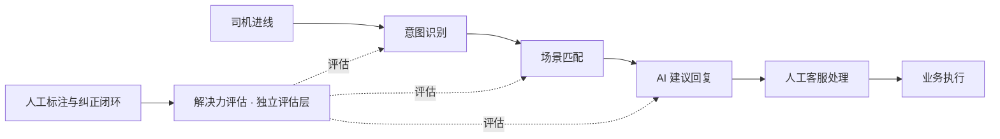

# 客服 AI 解决能力价值评估 — 业务需求及评估标准 V2.1

| 项 | 内容 |
|---|---|
| 系统命名 | 全称「客服 AI 解决能力价值评估」，简称「解决力评估」；"N检测"为曾用名 |
| 文档定位 | 业务需求定义 / 能力分级标准 / 纠正闭环与看板指标 |
| 当前状态 | 业务需求定稿建议版（V2.1 = V2.0 定位重构版 + 判读路径、示例集与治理补充） |
| 业务定位 | 客服 AI 问题解决能力评估与持续优化 |
| 最终解决标准 | 完整处理方案型 |
| 当前范围 | 客服内部使用，以批量检测为主，支持单条复核；暂不涉及技术架构与开发实现 |
| 版本说明 | V2.0 正文保持原意；新增与优化内容以【V2.1 补充】标注 |

---

# 第 0 章 定位、边界与评价哲学（V2.1 新增）

## 0.1 一句话定位

解决力评估是**面向客服 AI 决策链路的问题解决能力度量机制**：以原始客服会话为唯一事实输入，独立还原司机真实诉求，评价 AI 能否针对每个诉求提供一套正确、完整、有依据、可直接交付客服使用的处理方案；度量 AI 已经替代了客服哪些工作、还剩哪些工作；并通过人工标注、问题归因、标准治理与同口径复验，持续验证 AI 解决能力的真实提升。

## 0.2 评价标准的本质转变（本版最重要的定位）

解决力评估不再以 AI 意图、场景、回复是否准确作为最终评价目标，而以 **AI 能否提供完整处理方案**作为最终标准。两者存在本质区别：

| 维度 | 答案准确性评价（V1.0 及以前） | 完整处理方案型（V2.0 / V2.1） |
|---|---|---|
| 评价对象 | AI 的意图、场景、回复"有没有答错" | AI "能不能直接交付一套可用的处理方案" |
| 核心业务问题 | 答得对不对 | 替代了多少客服原本要做的查询、分析、判断、沟通 |
| 结论形态 | 逐环节：正确 / 错误 / 无法判断 | 逐环节：正确 / 错误 / 无法判断；诉求级整体：L0–L3 / U |
| 第一业务指标 | 意图准确率、场景准确率 | 完整方案可交付率（L3 率） |
| 与人工的关系 | 评估 AI 本身 | 评估"AI + 人工"的分工：AI 做了什么、人还剩下什么 |
| 典型风险 | 答对但不可用（信息正确，客服仍要重做分析） | 已通过五条原则与七维度检测约束规避 |

一句话概括：**答案准确性评价回答"AI 有没有错"，完整处理方案型评价回答"AI 能不能让客服少干活"。**

## 0.3 它是什么 / 它不是什么

| 它是 | 它不是 |
|---|---|
| 独立评估层：以原始会话为唯一事实输入，不复用被检测系统的结论作为答案 | 被检测系统（意图 / 场景 / AI 回复）的附属报表 |
| AI 解决能力的分级度量（L0–L3 / U） | 司机满意度或问题解决率的代理指标 |
| 人工剩余工作的识别器 | 实际工时与人力成本的统计器（一期不做，见 9.4） |
| 问题归因与纠正任务的生成器 | 线上规则的自动修改者（一期只检测与反馈） |
| 业务标准与基准样本的沉淀机制 | 一次性检测报告 |

## 0.4 在客服 AI 业务链路中的位置



定位说明：

1. 解决力评估横切在**意图识别、场景匹配、AI 建议回复**三个环节之上，作为旁观者独立评估，不介入、不修改线上。
2. **人工客服处理与业务执行两个环节一期不评价**——那需要人工采纳记录和实际业务状态数据（见 1.3 原则三、9.4）。
3. 人工标注与纠正闭环是回流来源：没有这一环，判定标准会停滞，误判会固化。

## 0.5 五条核心原则的相互关系（V2.1 补充）

- **原则一（关联不等于有效）是认识论前提**：防止把"提到了相关知识"误认为"具备了解决能力"。
- **原则二（答案正确不等于方案完整）与原则三（完整方案不等于实际执行成功）是方案完整性的两个支柱**：前者防止高估，后者防止把能力评价偷换成结果评价。
- **原则四（缺少依据不能强行判断）是证据纪律**：赋予系统"拒判权"，没有这一条，前三条都会被"凑结论"的冲动破坏。
- **原则五（以真实诉求为评价起点）是评价起点**：先还原司机真正的问题，再评价系统结果，避免循环论证。

五条合起来定义一个完整的评价立场：**从司机的真实问题出发，用证据说话，对"能否交付"下结论，证据不够就拒判。**

## 0.6 读者指南

| 读者 | 重点章节 | 使用方式 |
|---|---|---|
| 业务负责人 | 第 0、一、九、十章 | 判断建设范围、验收标准与风险 |
| 业务规则负责人 | 第三、五、六章、附录 B | 维护标准、裁决冲突 |
| 人工标注人员 | 第三、六章、附录 A/B | 分级判定与复核操作 |
| 产品 / PRD 编写 | 全文 | 派生功能需求与原型方案 |
| Agent 能力设计 | 第三、四章、附录 B | 分级判读逻辑与拒判规则 |
| 数据分析 | 第七章 | 指标口径与看板结构 |

---

# 一、业务背景与目标

## 1.1 业务背景

当前客服业务希望通过 AI 辅助或替代人工完成司机问题处理，减少客服在接待过程中的人工查询、问题分析、方案判断及答复组织工作。

最终实现：

- 降低客服单位问题处理成本。
- 缩短电话、在线会话的人工处理时间。
- 提高客服对司机问题的处理效率。
- 在保障解决质量的前提下，提升 AI 可承担的客服工作比例。

当前已具备意图识别、场景匹配和 AI 辅助答复能力，但缺少有效机制判断：

1. AI 是否真正理解司机需要解决的问题？
2. AI 是否匹配了正确的业务场景？
3. AI 是否提供了足够的事实、原因、依据和处理方案？
4. 客服是否还需要重新查询、分析、判断才能处理？
5. 如果 AI 不能提供完整方案，缺失的到底是什么能力？
6. 这些问题应该如何通过人工纠正和数据分析持续优化？

因此，需要建立解决力评估与纠正看板。

## 1.2 核心目标

**解决力评估的最终目标是评价 AI 的问题解决能力，而不只是答案准确性。**

具体分为三个层次：

| 层次 | 目标 | 业务价值 |
|---|---|---|
| 识别正确 | 意图、场景、业务理解准确 | 避免错误理解和错误处理 |
| 方案完整 | 提供正确、充分、可执行的解决方案 | 减少人工查询、分析和判断 |
| 人工替代 | 识别哪些客服工作已由 AI 完成，哪些仍需人工承担 | 指导降本增效和 AI 能力优化 |

其中「方案完整」是第一阶段的最终评价标准。

「人工替代」在一期先评估可替代的工作环节，实际节省的人工时间与成本，需要后续结合客服行为数据验证。

【V2.1 补充】三个层次的递进关系：识别正确是**必要条件**（认错了问题，方案再完整也没有意义）；方案完整是**最终标准**（第一阶段的评价终点）；人工替代是**业务落点**（把方案质量翻译成"客服能少做什么"）。三者不是三个并列指标，而是一条"前提 → 标准 → 价值"的链条——看板设计（第七章）即按此展开。

## 1.3 核心业务原则

**原则一：关联不等于有效。**

AI 只是提到了相关知识、规则或处理方向，不能认定其具备完整解决能力。

**原则二：答案正确不等于方案完整。**

AI 必须针对当前司机诉求，提供充分的事实依据、分析判断及必要的处理动作。

**原则三：完整方案不等于实际执行成功。**

当方案仍需人工执行业务操作时，只要 AI 已完成所需的判断、明确执行方式且方案正确，可以认定具备完整方案能力，但不能认定实际问题已经解决。

**原则四：缺少依据不能强行判断。**

对于缺少必要业务标准、数据或评价证据的情况，必须保留「无法判断」，不能通过 AI 自行推断补齐。

**原则五：以真实诉求而不是系统结果作为评价起点。**

检测需要先还原司机真实问题，再评价现有意图、场景和 AI 建议。

---

# 二、解决力评估的业务对象

## 2.1 输入信息

| 信息 | 主要内容 | 检测用途 |
|---|---|---|
| 原始会话 | 司机与客服的文本会话或语音转写 | 还原实际诉求 |
| 意图识别 | 原意图 ID、名称和识别结果 | 判断诉求识别准确性 |
| 场景匹配 | 当前命中的场景 ID 或分类 | 判断场景匹配准确性 |
| AI 建议回复 | AI 提供给客服的辅助答复 | 评价解决方案质量 |
| 业务标准 | 意图、场景、业务规则及标准答复 | 提供判断依据 |

允许业务标准不完整，但必须识别标准缺失对评价结果的影响。

【V2.1 补充】输入缺失的处理纪律：允许部分字段缺失，但必须"标记 + 降级判定"，不得"补造 + 照常判定"——缺失原意图，意图检测标记无法判断；缺失场景定义，场景检测标记无法判断，不得以"名称相似"代替判定；缺失 AI 建议，回复检测按本应产生与否标记无法判断或不适用。**材料给什么判什么，材料没什么标什么，绝不替被检测系统编结果。**

## 2.2 检测单位

采用三个层级：

**会话级：** 完整的司机与客服沟通记录。

**诉求级：** 从会话中识别主诉求及次诉求，分别评价。

**方案级：** 将 AI 针对诉求提供的建议作为检测对象。

一条会话可能存在多个诉求，不能因主诉求已正确识别，就默认整条会话处理完整。

例如司机同时反馈「保底奖励未到账」和「奖励金额少了 30 元」，需要分别评价两个诉求，最终汇总整条会话的方案覆盖情况。

如果现有意图系统只承担主意图识别，应将未识别次诉求记录为覆盖能力差距，不直接将全部遗漏判为模型错误。

【V2.1 补充】三个层级的职责分工：会话是上下文单元（诉求判断依赖完整对话）；诉求是归因单元（错误必须落到具体诉求才能归因）；方案是评价对象（AI 针对该诉求的建议）。主次诉求划分的三个实操难点：①追问不构成新诉求（"那多少钱"是补充），独立提出的其他问题构成（"另外我另一个奖励也不对"）；②情绪表达不单列为诉求，但作为证据保留；③可独立处理的复合诉求应拆分（参照 6.1 类示例）。

## 2.3 处理场景类型

不同问题的「完整方案」应采用不同标准。

| 问题类型 | 典型诉求 | 完整方案要求 |
|---|---|---|
| 规则咨询类 | 奖励如何计算、取消规则是什么 | 准确解释规则、适用条件及限制 |
| 业务查询类 | 奖励为什么没到账、订单状态异常 | 根据可用事实解释当前状态及原因 |
| 操作指导类 | 如何修改信息、如何提交申诉 | 明确操作条件、步骤、结果及异常处理 |
| 异常处理类 | 奖励计算错误、账户异常 | 判断异常条件、给出处理路径及责任归属 |
| 判责争议类 | 司机不认可违规、要求撤销处罚 | 基于证据和规则解释判定依据、申诉或复核路径 |

不同类型的问题，不应该要求 AI 使用完全相同的答复模板。

但必须统一评价其是否提供了当前问题所需的完整解决路径。

【V2.1 补充】五类问题的完整方案判读要点（用于第三、四章落地）：

| 问题类型 | 完整方案的最小充分条件 | 最常见的"假完整" |
|---|---|---|
| 规则咨询类 | 规则条文 + 适用条件 + 限制 + 针对该司机的适用结论 | 只贴规则全文，没说这条规则对该司机意味着什么 |
| 业务查询类 | 该司机的实际状态事实 + 状态原因 + 后续预期 | 只给通用时效（"一般 3 个工作日"），未查该司机实际情况 |
| 操作指导类 | 前置条件 + 步骤 + 每步结果 + 异常分支 | 只给入口，不说条件与失败处理 |
| 异常处理类 | 异常判定依据 + 处理路径 + 责任归属 + 司机侧动作 | 只罗列可能性，未形成判断 |
| 判责争议类 | 证据清单 + 规则依据 + 判定结论 + 申诉或复核路径 | 只重复处罚结果，未给依据与申诉通道 |

---

# 三、AI 解决能力分级标准

## 3.1 统一分级定义

| 等级 | 定义 | 客服仍需完成的工作 | 业务价值 |
|---|---|---|---|
| **L3 完整方案可交付** | AI 提供正确、完整、有依据的处理结论与方案，客服无需重新分析如何处理 | 可以直接转述、确认或按明确步骤执行 | 高 |
| **L2 有效辅助** | AI 已完成部分有价值的查询、分析或方案判断，但仍缺少关键事实或决策 | 需要补充查询、判断或完善方案 | 中 |
| **L1 仅信息相关** | AI 只提供相关知识、线索或通用解释，没有实质完成当前问题的处理判断 | 主要查询与分析仍需人工完成 | 低 |
| **L0 错误或不可用** | 存在明确的关键错误、错误处理方向或不可接受的误导风险 | 需要人工纠错甚至重新处理 | 负向或无效 |
| **U 无法判断** | 缺少必要业务规则、事实或判断依据 | 需要补充标准或证据 | 暂不可评价 |

### L3：完整方案可交付

必须同时满足：

1. 准确理解当前司机诉求。
2. 正确使用当前可获得的业务事实和有效规则。
3. 能够解释当前问题的原因，或明确哪些原因已确认、哪些尚待核实。
4. 给出完整的处理判断、方案和必要操作路径。
5. 不需要客服重新分析「到底应该怎么处理」。
6. 能形成客服可直接使用的司机沟通内容，必要时明确解释依据、条件和下一步。
7. 不存在未经证实的事实、违规承诺或高风险错误。

对于必须进行业务操作的问题，L3 允许客服执行已经明确的操作步骤，但不能要求客服重新调查问题并自行设计处理方案。

### L2：有效辅助

AI 已经完成具有实际价值的部分工作，例如：

- 正确定位了需要检查的业务对象。
- 找到适用的部分业务规则。
- 明确了部分异常原因。
- 给出了合理处理方向。

但仍需客服进行关键查询、补充分析或确认方案。

**关键界限：AI 减少了人工工作，但尚未形成完整可交付的处理方案。**

### L1：仅信息相关

包括：

- 仅复述司机的问题。
- 仅给出一般性的业务规则。
- 仅提供相关查询入口。
- 仅建议「耐心等待」「联系客服核实」，没有解释具体处理依据。
- 内容虽然与问题有关，但客服仍需从头开展主要分析。

### L0：错误或不可用

包括：

- 识别错误诉求，导致解决方向明显错误。
- 存在已证实的关键事实错误。
- 给出违反已确认业务规则的处理建议。
- 错误承诺金额、到账时效或责任认定。
- 给出可能造成司机权益损失的错误处理路径。

### U：无法判断

当关键判断缺少充分证据时使用，例如：

- 缺少当前有效的奖励规则。
- 无法确认 AI 引用的司机订单或账户状态。
- 无法确认场景 ID 的实际业务定义。
- 语音转写缺失关键内容。

如果已能明确发现关键错误，可记录该错误；其他缺少依据的检测项仍保留无法判断。

不能因为没有发现错误，就自动认定 L3。

【V2.1 补充一】分级判读决策路径（按顺序执行，第一步命中即定）：

```
第一步：是否存在已确认的关键错误（事实错误 / 违规建议 / 错误承诺 / 方向性错误）？
  是 → L0（同时逐项记录错误明细，其余维度结论保留）
第二步：关键维度是否缺少必要证据（标准缺失 / 事实缺失 / 规则缺失）？
  是 → U（必须带原因分类；已发现的错误单独记录，不因 U 状态豁免）
第三步：客服是否仍需重新分析"这个司机的问题怎么处理"（查询、归因、方案决策未完成）？
  仍需要，且 AI 有实质价值输出 → L2
  仍需要，且 AI 仅提供相关信息、通用规则或查询入口 → L1
第四步：无需重新分析，客服只需转述、确认或执行已明确的步骤 → L3
```

【V2.1 补充二】L2 / L3 边界细则（全体系最易混淆处）：

判据**不是信息量多少，而是"客服是否需要重新做处理判断"**：

- AI 给了 10 条规则，但都没有针对当前司机的情况落地 → 仍可能只是 L1。
- AI 只说了 2 句话，但准确指出了当前订单的异常原因和处理路径 → 可以 L3。

定级自检三问（全部通过才可 L3）：

1. 客服看完是否已经知道"这个司机的问题是什么原因、该怎么处理"？
2. 方案是否覆盖当前诉求的全部必要环节（含前提、分支、司机侧动作）？
3. 是否还存在需要客服自行查证的关键未知（订单状态、账户信息、规则适用性）？

三问分别为"是、是、否" → L3；任何一问为否，按缺口性质落入 L2 / L1 / U。

【V2.1 补充三】常见误判提醒：

1. **把"语气好、条理清"当 L3**——表达质量不等于方案完整，沟通交付只是七维度之一。
2. **把"提到了正确规则"当 L2 / L3**——规则未针对当前诉求应用的，只是 L1。
3. **把"没有发现错误"当 L3**——没有证据不下结论（原则四）。
4. **把"司机最后说谢谢"当 L3**——司机认可是会话结果信号，不是方案质量证据；且"司机明确接受且不再追问"属于真实解决维度，一期不纳入核心评价（见第十二章事项 7）。
5. **把"步骤很长"当完整**——步骤多但缺关键分支或责任归属，仍不满足 L3 第 4 条。

## 3.2 必须增加「人工剩余工作」维度

解决能力等级和人工工作量相关，但不能完全等同。

建议每条诉求同时记录以下人工剩余工作：

| 工作环节 | 评价内容 |
|---|---|
| 信息查询 | 客服是否还需要自行查询关键业务数据 |
| 原因分析 | 客服是否还需要分析为什么发生问题 |
| 方案判断 | 客服是否还需要决定采取哪种处理方式 |
| 沟通组织 | 客服是否还需要重新整理答复依据及表达 |
| 业务执行 | 是否仍需人工执行明确的业务操作 |

每项标记为：

- AI 已完成。
- 人工仍需完成。
- 本次不需要。
- 无法判断。

例如 AI 已完成查询、分析、方案决策和答复组织，但退款仍需要人工操作。

此时可以评价为 L3 完整方案，同时记录「人工仍需执行」。

这样既不会低估 AI 的辅助价值，也不会错误地宣称 AI 已经完全替代人工。

【V2.1 补充】等级与剩余工作的组合使用规则：

| 组合 | 是否合法 | 说明 |
|---|---|---|
| L3 + 业务执行"人工仍需完成" | 合法且常见 | 方案可交付，操作要人做；写入看板第三层"仍需人工执行率" |
| L3 + 查询/分析/判断/沟通任一"人工仍需完成" | 矛盾，降级复核 | 说明方案并未真正可交付，应回落 L2 并记录缺口 |
| L2 + 任一环节"人工仍需完成" | 合法 | L2 的定义本身就是"有剩余的关键工作" |
| U + 剩余工作"无法判断" | 合法 | 证据不足时，剩余工作同样无法判定 |

---

# 四、解决力评估的完整评估标准

检测分为四个层次。

## 4.1 第一层：真实诉求与意图检测

| 检测项 | 判断标准 |
|---|---|
| 诉求还原 | 是否准确识别司机真正要求解决的问题 |
| 主意图准确 | 原系统意图是否与真实主诉求匹配 |
| 次诉求覆盖 | 是否遗漏了需要独立处理的其他诉求 |
| 意图边界 | 是否存在相似意图之间的歧义 |
| 意图标准覆盖 | 当前意图体系是否具备适用分类 |

输出意图错误、遗漏、边界冲突、标准缺失等问题。

## 4.2 第二层：场景检测

| 检测项 | 判断标准 |
|---|---|
| 场景匹配 | 是否命中真实诉求适用的场景 |
| 场景关联 | 意图与场景是否符合有效映射规则 |
| 场景边界 | 是否存在多个场景定义重叠 |
| 场景覆盖 | 是否存在应有但缺失的处理场景 |

场景定位为分类或场景 ID，不直接评价场景内部 SOP 执行是否正确。

## 4.3 第三层：解决方案质量检测

| 检测维度 | 核心问题 | L3 必须达到的状态 |
|---|---|---|
| 事实充分性 | AI 是否掌握了解决问题所需的关键事实 | 必要事实有依据，未确认信息被明确标识 |
| 原因分析 | AI 是否解释了问题原因 | 能得出有证据的结论，不能确定时不虚构 |
| 业务判断 | AI 是否依据事实和规则正确判断 | 判断条件与结果相匹配 |
| 处理方案 | AI 是否知道应该如何解决 | 步骤、责任、顺序及关键分支完整 |
| 可执行性 | 方案能否在当前业务条件下执行 | 无不存在的操作或不可满足的前提 |
| 沟通交付 | 客服能否直接向司机解释或执行 | 内容清晰、有依据、可直接使用 |
| 风险控制 | 是否存在错误承诺或误导 | 不存在已确认的关键风险问题 |

**方案的最终判断必须是整体判断，不能通过各维度平均分抵消关键问题。**

如果事实分析存在关键错误，即使回复表达优秀，也不得评为 L3。

如果处理步骤完整，但缺少确认其适用性所必需的业务规则，则保留 U，而非强行给予 L3。

【V2.1 补充一】七个维度的逻辑关系：

- **事实充分性是地基**：没有事实，原因分析与业务判断都是空谈。
- **原因分析与业务判断是核心**：AI 替代人工的主要就是这两件事。
- **处理方案是产出**：步骤、责任、顺序、分支。
- **沟通交付是包装**：能否直接转述给司机。
- **可执行性是约束**：方案能不能在当前业务条件下落地。
- **风险控制是否决项**：一票否决，且向 L0 倾斜。

【V2.1 补充二】整体判断规则与关键维度界定（建议，待业务确认）：

整体判断规则：

- 任一**关键维度**存在明确错误 → 不得 L3；错误性质属关键事实错误、违规建议、错误承诺、方向性错误的 → L0。
- 任一**关键维度**无法判断 → 整体 U（其他无错误维度结论保留）。
- 全部关键维度达标，且支撑维度无明确错误 → L3。

关键维度界定建议：**事实充分性、原因分析、业务判断、处理方案、风险控制默认为关键维度；沟通交付默认为支撑维度**（司机明确要求解释或告知的场景除外，此时升级为关键）。此界定直接影响 U 与 L3 的边界，建议在首批基准样本校准时确认（见第十二章事项 5）。

## 4.4 第四层：人工替代能力检测

在方案质量评价基础上，回答：

- AI 已经帮助客服完成哪些工作？
- 客服还需要自己完成哪些工作？
- 哪些工作属于简单执行，哪些仍需要独立分析和判断？
- AI 没有完成这些工作的根本原因是什么？

这一层主要用于识别降本机会，而不是直接计算实际节约的人力成本。

---

# 五、问题归因与纠正标准

## 5.1 归因体系

| 问题类型 | 具体缺陷 | 优化对象 |
|---|---|---|
| 诉求理解问题 | 意图错配、次诉求遗漏、上下文理解错误 | 意图识别 |
| 场景问题 | 场景匹配错误、分类冲突、覆盖不足 | 场景体系 |
| 数据不足 | 无法取得订单、奖励、账户等必要事实 | 业务数据与查询能力 |
| 业务知识不足 | 规则缺失、过期、定义冲突 | 业务标准和知识 |
| 原因分析不足 | 只罗列可能性，没有基于事实形成判断 | AI 分析能力 |
| 方案决策不足 | 缺少处理分支、条件或下一步 | 解决方案能力 |
| 沟通能力不足 | 无法形成完整、易理解的客服答复 | 回复组织能力 |
| 执行能力不足 | 方案正确但需要人工完成操作 | 业务执行能力 |
| 检测证据不足 | 输入材料缺失、标准不足、转写不清 | 数据与评价标准治理 |

归因必须区分：

- **直接问题：** 当前检测发现的实际缺陷。
- **已确认根因：** 有充分证据证明的原因。
- **可能根因：** 合理怀疑但尚未证明的原因。
- **连锁影响：** 上游问题引发或可能引发的后续偏差。

同一个诉求可以存在多个错误，但不能在统计中将一次问题的连锁影响简单视为多个独立根因。

【V2.1 补充】根因置信度的使用规则：

- **已确认**：必须能描述完整因果链条的证据（如"意图错误 → 路由到风控场景 → 回复解释风控规则"，每步有记录支撑）。
- **可能根因**：存在合理关联但缺一环证据——保留为可能根因，进入人工复核优先级，不得写入统计的根因分布。
- **无法归因**：证据不足以下任何结论——记录现象，不强行归因。

统计口径：直接问题可以多发；根因统计必须去重（一次连锁异常只计一个根因）；可能根因与无法归因不计入"已确认根因"分母。

## 5.2 纠正任务定义

每个待纠正事项需要包含：

| 字段 | 业务要求 |
|---|---|
| 问题对象 | 意图、场景、知识、分析、回复等 |
| 问题描述 | 明确指出当前不足 |
| 原始证据 | 关联会话和 AI 建议 |
| 影响范围 | 关联的诉求、意图、场景和样本数量 |
| 当前能力等级 | L0/L1/L2/L3/U |
| 期望能力等级 | 目标改善至哪个等级 |
| 问题归因 | 已确认或待确认原因 |
| 改进建议 | 需要补充哪项知识、标准或业务能力 |
| 人工结论 | 复核及业务裁决结果 |
| 复验结果 | 改进后在相同评价标准下是否有效 |

纠正任务必须区分「评价标准修正」与「原 AI 能力修正」，不能把修改解决力评估判定规则当成原 AI 业务能力已经提升。

## 5.3 纠正优先级

优先级建议根据三个因素决定：

1. **影响规模：** 问题发生次数、覆盖诉求数量及业务集中度。
2. **人工替代潜力：** 修正后能否减少大量查询、分析和沟通工作。
3. **业务风险：** 是否涉及资金、司机权益、错误判责或其他重大影响。

建议优先处理：

- 高频 L1 问题中，可通过补充事实或方案升级到 L3 的场景。
- 高频 L2 问题中，人工重复分析成本高的场景。
- L0 中具有明显业务风险的问题。
- 大量 U 样本中，由同一标准缺失造成的不可评价问题。

不能只按照错误数量排序，否则容易忽视高价值的人工替代机会。

---

# 六、人工标注与纠正闭环

## 6.1 标注目标

人工标注同时承担：

1. 校验和修正解决力评估结论。
2. 建立可信的评价样本。
3. 补齐、确认或纠正业务标准。
4. 识别可复用的完整解决方案。
5. 复验纠正后 AI 的实际能力变化。

## 6.2 标注内容

每条诉求至少标注：

| 标注类别 | 具体内容 |
|---|---|
| 真实诉求 | 主诉求、次诉求、原文依据 |
| 意图结果 | 正确、错误、无法判断及原因 |
| 场景结果 | 正确、错误、无法判断及原因 |
| 方案评价 | L0/L1/L2/L3/U |
| 能力缺口 | 缺事实、缺分析、缺方案、缺沟通等 |
| 人工剩余工作 | 查询、分析、判断、表达、执行 |
| 完整方案基准 | 经确认的解决依据、判断条件与处理路径 |
| 标注证据 | 会话片段、适用规则及版本 |
| 最终结论 | 人工确认、改判、争议或标准待完善 |

对于无法判断的样本，人工可以补充有效标准和证据，但不能在标准仍缺失时强行确认为正确或错误。

## 6.3 纠正闭环

**检测 → 人工复核 → 问题分类 → 业务标准确认 → 能力改进 → 同口径复验 → 效果统计。**

其中：

- 高风险错误、标准缺失、争议样本优先复核。
- L3 样本也必须进行一定比例随机抽检，防止错误高估 AI 能力。
- 建立独立人工基准样本，不能仅依赖解决力评估自身结果证明其准确。
- 业务标准修改应保留版本和生效时间。
- 改进前后应在相同样本和评价口径下对比，避免因样本变化得出错误提升结论。

【V2.1 补充】为什么必须抽检 L3 样本：如果只复核系统报告的错误，只能衡量误报（报错但其实没错），无法发现漏检（有错但没报）——而漏检恰恰是能力评估最危险的失效模式，它会系统性地高估 L3 率。对判定 L3 的记录按比例随机抽检，才能用人工基准校准漏检率。这条纪律的本质：**不能让被评估者只参加自己擅长的考试。**

---

# 七、检测与纠正看板：指标标准

看板不应只是展示意图准确率或 AI 回复错误率，而应形成：

**问题解决能力 → 人工替代潜力 → 能力缺口 → 纠正进展 → 复验效果**

五个相互关联的分析层次。

## 7.1 第一层：AI 解决能力总览

### 核心指标

| 指标 | 计算口径 | 说明 |
|---|---|---|
| 完整方案可交付率 | L3 诉求数 / 可评价诉求数 | 核心业务评价指标 |
| 有效辅助覆盖率 | (L2 + L3) 诉求数 / 可评价诉求数 | 衡量 AI 有实质辅助价值的比例 |
| 仅相关不足率 | L1 诉求数 / 可评价诉求数 | 发现未形成解决方案的情况 |
| 错误或不可用率 | L0 诉求数 / 可评价诉求数 | 衡量已确认的严重能力缺陷 |
| 可评价覆盖率 | L0—L3 诉求数 / 应检测诉求数 | 判断评价体系覆盖程度 |
| 无法判断率 | U 诉求数 / 应检测诉求数 | 识别标准及证据缺口 |

这里「可评价诉求数」指已经有充分证据确定为 L0—L3 的诉求。

建议同时报告：

**全量 L3 覆盖率 = L3 诉求数 / 应检测诉求数。**

该指标保守反映当前已有证据证明具备完整方案能力的覆盖范围，不应将 U 自动视为失败。

### 会话级指标

另外需要统计：

- 完整方案覆盖整条会话的比例。
- 存在至少一个未有效处理诉求的会话比例。
- 多诉求会话完整覆盖率。

同一条会话包含多个诉求时，只有所有需处理诉求都达到 L3，才能评价整条会话达到完整方案覆盖。

【V2.1 补充】分母口径定义表（看板与报表必须统一使用）：

| 口径 | 定义 |
|---|---|
| 应检测诉求数 | 本次导入批次中全部识别出的诉求（含 U） |
| 可评价诉求数 | 已有充分证据确定为 L0–L3 的诉求（不含 U） |
| 可评价建议数 | 关联到可评价诉求、且存在 AI 建议内容的建议数 |
| 可评价主意图数 | 具备有效意图标准、且无标准缺失或信息缺失的主意图数 |
| 全量 L3 覆盖率 | L3 诉求数 / 应检测诉求数（保守口径，防止"挑简单样本考"） |

## 7.2 第二层：AI 决策链路质量

| 指标 | 定义 |
|---|---|
| 主意图准确率 | 正确主意图数 / 可评价主意图数 |
| 次诉求覆盖率 | 已正确覆盖的次诉求数 / 可评价且应覆盖的次诉求数 |
| 场景匹配准确率 | 正确匹配场景数 / 可评价场景数 |
| 条件场景准确率 | 意图正确时场景正确数 / 意图正确且可评价的场景数 |
| 事实依据合格率 | 事实使用满足标准的建议数 / 可评价建议数 |
| 原因分析合格率 | 原因分析符合规则与证据的建议数 / 可评价建议数 |
| 方案完整率 | 满足方案完整性标准的建议数 / 可评价建议数 |
| 沟通可交付率 | 能直接用于司机沟通的建议数 / 可评价建议数 |

这些指标用于解释完整方案可交付率为什么高或低。

不能将几个过程指标简单平均后作为最终 L3 结果。

## 7.3 第三层：人工替代潜力

这是区别于常规客服质检看板的重点。

| 指标 | 评价方式 | 业务作用 |
|---|---|---|
| 无需再次查询率 | AI 已提供必要事实，无需客服再查询的诉求占比 | 识别查询工作替代潜力 |
| 无需再次分析率 | AI 已完成关键原因分析的诉求占比 | 识别分析工作替代潜力 |
| 无需再次决策率 | AI 已明确适用方案的诉求占比 | 识别判断工作替代潜力 |
| 答复直接可用率 | AI 生成内容能够直接用于司机沟通的占比 | 识别沟通工作替代潜力 |
| 仍需人工执行率 | 完整方案中仍需人工完成操作的诉求占比 | 识别执行能力边界 |

这些指标在一期属于基于会话、方案和业务标准的**能力评价**，不是实际节省工时的统计。

需要明确标注「预计可替代工作环节」或「无需人工二次处理的评价结论」，不能直接等同于真实客服操作数据。

## 7.4 第四层：问题归因及优化机会

需要呈现：

| 分析对象 | 核心内容 |
|---|---|
| 按意图 | 各意图 L0—L3/U 分布、错误量与完整方案率 |
| 按场景 | 各场景完整方案率、主要缺陷和标准覆盖 |
| 按能力缺口 | 缺事实、缺知识、缺分析、缺方案、缺沟通等 |
| 按人工工作 | 哪些问题仍需要大量人工查询或判断 |
| 按风险 | 高风险错误及其影响范围 |
| 按优化潜力 | 高频、低解决能力、高人工工作量的场景 |

该层最终应能够明确回答：

**当前优先优化哪些意图或场景，能够让 AI 承担更多实际客服工作？**

## 7.5 第五层：纠正与能力提升

| 指标 | 定义 |
|---|---|
| 待纠正问题数 | 已确认但尚未完成修正的问题事项数 |
| 问题复核完成率 | 已完成复核数 / 应复核数 |
| 标准问题关闭率 | 已完成确认的标准问题数 / 应裁决标准问题数 |
| 纠正复验通过率 | 修正后达到预期标准的事项数 / 已完成复验事项数 |
| L1→L3 转化率 | 同一基准样本中由 L1 提升至 L3 的比例 |
| L2→L3 转化率 | 同一基准样本中由 L2 提升至 L3 的比例 |
| L3 保持率 | 原 L3 样本在能力改进后仍满足 L3 的比例 |
| 高风险问题回归数 | 改进后重新出现的已确认高风险错误数量 |

所有能力提升指标都应采用相同的样本集合、评价标准或经过版本差异校正的口径。

不能简单比较不同月份原始完整方案率，直接认定 AI 能力提升，因为司机诉求结构和样本复杂度可能发生变化。

【V2.1 补充】指标解读三条纪律：

1. **分母口径必须披露**：每个指标注明分子、分母与"可评价"的判定条件（统一使用 7.1 口径定义表）。
2. **无法判断必须同披露**：完整方案可交付率旁边必须并列无法判断率与全量 L3 覆盖率，防止只评价简单样本造成结果虚高。
3. **能力提升指标必须同口径**：L1→L3、L2→L3、L3 保持率只能使用同一基准样本集合计算，跨期对比必须说明样本与标准版本差异。

---

# 八、看板应支持的核心业务分析

## 8.1 总览分析

回答：

- 本次检测多少条会话、多少个诉求？
- 多少诉求具备完整方案？
- 多少只能部分辅助？
- 多少只是提供相关信息？
- 多少存在明确错误？
- 多少因为标准或证据不足无法判断？

## 8.2 意图及场景分析

回答：

- 哪些意图识别准确，但 AI 仍无法提供完整方案？
- 哪些场景 L1 占比高？
- 哪些场景主要因为缺少业务数据导致无法形成方案？
- 哪些场景具备从 L2 升级至 L3 的潜力？

## 8.3 人工替代机会分析

回答：

- 哪些司机问题已经可以由 AI 完成关键分析和方案判断？
- 哪些问题仍然需要客服从头查询？
- 哪些场景只需要完善回复表达即可达到可交付？
- 哪些场景必须补齐业务数据、知识或执行能力才能进一步提升？

## 8.4 纠正效果分析

回答：

- 当前正在纠正什么问题？
- 改进前的能力等级是什么？
- 改进后是否达到 L3？
- 是否引入了新的错误或退化？
- 是否存在重复出现、未能解决的能力缺陷？

---

# 九、第一阶段业务验收标准

## 9.1 检测能力验收

应验证以下事项：

1. 能够批量接收会话、意图、场景和 AI 建议。
2. 能够独立还原主次诉求。
3. 能分别评价意图、场景和建议回复。
4. 能按照完整处理方案标准输出 L0—L3/U。
5. 不得仅依据语义关联性判定方案有效。
6. 缺少必要标准时不能强行判定为正确。
7. 能指出 AI 未形成完整方案的具体原因。
8. 能指出仍需要人工完成的工作环节。
9. 能形成可复核的判断证据。
10. 能保留人工纠正和业务标准的变更依据。

## 9.2 人工标注验收

应验证：

- 人工能够修正检测结论。
- 人工能够标注意图、场景和方案质量。
- 能够区分原始检测结论和人工最终结论。
- 对于标准缺失，可提交标准完善事项。
- 对于有争议的结论，可保留争议状态并进行业务裁决。
- 经过业务确认的样本可以用于后续复评。

## 9.3 看板验收

应满足：

- 能看到整体完整方案可交付率。
- 能按意图、场景、能力等级分析。
- 能追溯至单条会话及诉求。
- 能区分 AI 过程正确性与完整方案能力。
- 能展示主要能力缺口和人工剩余工作。
- 能跟踪纠正任务及改进前后的结果。
- 能单独展示无法判断和标准缺失情况。

## 9.4 效果验收边界

一期应主要验收：

**解决力评估是否准确反映 AI 当前问题解决能力，并能够指导纠正和改进。**

不直接承诺：

- 客服平均处理时长减少多少分钟。
- 人力成本降低多少百分比。
- 实际司机问题解决率提升多少。

这些指标必须在后续有客服采纳、实际操作、处理时长及业务结果数据时，才能建立可信测量。

---

# 十、最终业务目标与产出

解决力评估第一阶段形成四类业务产出：

**一、AI 问题解决能力评价**

明确每类司机问题是否达到完整方案标准，以及存在什么能力缺口。

**二、人工替代潜力分析**

明确查询、分析、判断、沟通及业务执行中，哪些工作 AI 已经能够承担。

**三、检测纠正与人工标注体系**

形成检测、人工确认、问题归因、标准治理和能力复验闭环。

**四、客服 AI 能力提升看板**

从整体能力、意图场景、缺陷归因、人工替代潜力及纠正效果五个维度持续评估。

**最终业务判断标准：**

AI 不只是能够回答司机的问题，而是能够形成一套正确、完整、有依据、可交付的处理方案，使客服不再需要重复完成原本的查询、原因分析和方案判断工作。

解决力评估的价值，就是不断发现 AI 距离这一目标还差什么，并验证这些差距是否真正得到改善。

## 看板优先突出的四个核心指标

| 指标类型 | 指标 | 回答的问题 |
|---|---|---|
| 核心结果指标 | 完整方案可交付率 | 有多少问题 AI 已具备完整解决方案能力 |
| 能力覆盖指标 | 有效辅助覆盖率 | 有多少问题 AI 已承担实质性工作 |
| 人效机会指标 | 人工剩余工作分布 | 客服仍需查询、分析、判断、沟通还是执行 |
| 优化效果指标 | 纠正后 L3 转化率 | 纠正是否真正提升完整方案能力 |

其中，完整方案可交付率应成为解决力评估的第一业务指标，意图准确率、场景准确率、事实正确率和回复质量都属于支撑指标。

但有一个边界不能忽视：如果某类司机问题必须实时查询订单状态，现有输入又没有提供订单数据，那么即使 AI 给出了看似完整的答案，也不能证明它能够正确解决该问题。这时应明确缺失事实与判断证据，不能为了提高 L3 占比而降低标准。

最终，用一句话界定解决力评估的价值：

> 以客服实际解决司机问题所需要完成的工作为标准，评价 AI 是否具备完整处理能力，识别人工仍需介入的原因，通过检测、纠正和复验持续提升 AI 对客服工作的替代能力，最终服务于客服降本增效。

---

# 十一、需求决策溯源（V2.1 新增）

本表用于业务评审时对齐"每个结论来自哪次讨论确认"，避免评审现场重新争论已决事项。

| 阶段 | 关键决策 | 文档落点 |
|---|---|---|
| 第一轮讨论 | 六层检测框架、三类输入方式 | 第二章 |
| 第二轮讨论 | 解决定义（司机明确接受且不再追问）、标准载体（自然语言规则+场景清单+正负案例）、AI 答复对象（客服机器人）、复核三态看板、实时判定优先、小范围试用 | 1.3、第三章、第六章、第十二章事项 7 |
| 第三轮讨论 | 证据不足拒判、不补造标准、独立评估、逐层判断 | 1.3 原则四/五、第 0.5 章 |
| V1.0 定稿 | 分环节验证 + 四态判定（正确/错误/无法判断/不适用）+ 归因体系 | V1.0 全文（已被 V2.0 吸收） |
| V2.0 转向 | 评价终点从"答案准确性"调整为"完整处理方案能力"；引入 L0–L3/U 分级、人工剩余工作五环节、纠正任务与看板五层指标 | 第 0.2 章、第三、四、七章 |
| V2.1 定名 | 正式命名「客服 AI 解决能力价值评估」（简称解决力评估），弃用 N检测；补充判读路径、边界细则、分母口径、示例集 | 第 0 章、附录 B、附录 C |

---

# 十二、遗留待确认事项（V2.1 新增）

以下事项不影响本文档作为需求基线评审，但进入 PRD 编写前需要逐项关闭。

| # | 事项 | 待确认内容 | 影响范围 | 建议 |
|---|---|---|---|---|
| 1 | 复核动作定义 | 是否仅"确认通过 / 驳回并修正"两类；修正是否留痕、不覆盖原结论 | 6.2、复核平台交互 | 两类操作 + 修正留痕 |
| 2 | AI 判别建议的沉淀 | 标准未覆盖时 AI 出判别建议，人工确认后是否生成草稿条目 | 标准库自生长 | 先生成"待确认草稿"，业务规则负责人确认后转正 |
| 3 | 判定触发方式 | 单条：粘贴即判 vs 按钮触发；批量：逐条实时 vs 整体汇总 | 使用方式、交互与性能 | 单条即判、批量逐条实时出结果 |
| 4 | 部署形态 | 本地网页 vs 多人访问链接；是否需要简单登录区分复核员/查看者 | 使用范围、技术方案 | 先小范围访问，登录与权限后置 |
| 5 | 关键维度界定 | 七维度中哪些为"关键"（决定一票否决与 U 边界） | 3.1、4.3 分级判定 | 前五项默认为关键、沟通交付默认为支撑——需首批基准样本校准确认 |
| 6 | 完整方案基准库 | 经确认的 L3 基准样本由谁维护、多久更新、如何进入复验样本集 | 第六章、7.5 复验口径 | 业务规则负责人主导，按月更新 |
| 7 | 真实解决核验的衔接 | "司机明确接受且不再追问"（第二轮确认的解决定义）一期不纳入核心评价，但属于项目最初的核心诉求之一 | 看板口径、二期范围 | 一期以"记录字段"预留（只记录不评价），二期优先评估；看板明确分区"方案能力"与"会话结果"，避免混读 |

---

# 附录 A 术语表（V2.1 新增）

| 术语 | 定义 |
|---|---|
| 解决力评估 | 「客服 AI 解决能力价值评估」的简称；本系统正式名称 |
| 会话 | 一条司机与客服的完整沟通记录（含文本/语音转写），上下文分析的基础单元 |
| 诉求 | 会话中提取出的具体待解决问题；分主诉求（最核心）与次诉求（有独立处理需求） |
| 完整方案 | 正确、完整、有依据、可直接交付客服使用的处理方案（L3 的判定对象） |
| 人工剩余工作 | 客服仍需完成的查询、分析、判断、沟通、执行五类工作 |
| 意图 | 被检测系统对诉求的识别标签（名称 + ID） |
| 场景 | 意图识别后命中的业务场景分类或场景 ID（不含场景内 SOP 执行正确性） |
| AI 建议回复 | 提供给人工客服参考的 AI 生成建议（一期评估对象） |
| 能力分级 | L0 错误或不可用 / L1 仅信息相关 / L2 有效辅助 / L3 完整方案可交付 / U 无法判断 |
| 检测维度 | 方案质量检测的七个维度：事实充分性、原因分析、业务判断、处理方案、可执行性、沟通交付、风险控制 |
| 关键维度 | 其错误一票否决 L3、其无法判断导致整体 U 的维度（界定见 4.3 与第十二章事项 5） |
| 可评价诉求 | 已有充分证据确定为 L0–L3 的诉求；指标计算的分母基础 |
| 应检测诉求 | 本次批次全部识别出的诉求（含 U）；全量 L3 覆盖率的分母 |
| 纠正任务 | 从检测问题沉淀出的可追踪纠正事项（字段见 5.2） |
| 基准样本 | 经人工确认的 L0–L3/U 典型样本；复验与能力对比的统一口径 |
| 同口径复验 | 使用相同样本集合与评价标准对改进前后能力进行对比 |
| 标准版本 | 业务标准的生效时间与版本号；新标准不覆盖历史判断语境 |
| N检测（曾用名） | 本系统内部代号，V2.1 起弃用 |

---

# 附录 B 分级判定示例集（V2.1 新增）

以下示例用于校准 L0–L3/U 的判定手感，建议作为首批人工基准样本的种子。

## B.1 示例 1：L3 完整方案可交付（规则咨询类）

司机：「保底奖励怎么算的？上周跑了 5 天怎么只有 200？」

AI 建议：「保底奖励规则：高峰完单量 ≥ 20 单时保底 300 元。您上周高峰完单 18 单，未达 20 单门槛，按完单阶梯计得 200 元，计算口径附后。如对完单数有异议，可在 7 日内通过"我的-奖励申诉"提交，需附行程截图，受理后 3 个工作日内反馈。」

| 检测维度 | 结论 | 依据 |
|---|---|---|
| 事实充分性 | 达标 | 引用该司机实际上周完单数据 |
| 原因分析 | 达标 | 指出未达门槛及计得 200 的原因 |
| 业务判断 | 达标 | 条件与结果匹配 |
| 处理方案 | 达标 | 含申诉路径、材料与时限 |
| 沟通交付 | 达标 | 可直接转述 |
| 风险控制 | 达标 | 无未证实承诺 |

**结论：L3。** 人工剩余工作：查询/分析/判断/沟通均为 AI 已完成，执行本次不需要。

## B.2 示例 2：L2 有效辅助（业务查询类，同一司机的弱回复）

司机：「上周的保底奖励还没到账，而且金额少了 30 元。」

AI 建议：「奖励未到账通常与完单量核算有关，奖励一般在 3 个工作日内到账，请您耐心等待，如需核实可联系客服。」

| 检测维度 | 结论 | 依据 |
|---|---|---|
| 事实充分性 | 不足 | 未查该司机订单与核算状态 |
| 原因分析 | 不足 | 仅给通用可能性 |
| 业务判断 | 不足 | 未针对金额少了 30 元作判断 |
| 处理方案 | 不足 | 无处理路径 |

**结论：L2。** 有相关信息但客服仍需查询核算状态、判断金额差异原因。人工剩余工作：查询/分析/判断/沟通均为人工仍需完成。

要点：「提到了相关规则」不等于 L3；客服仍需从头查证 → L2（呼应原则一）。

## B.3 示例 3：L1 仅信息相关

AI 建议：「您的问题属于奖励类问题，您可以查看平台的奖励规则，如有疑问可以联系客服核实。」

**结论：L1。** 仅归类复述 + 通用入口，未针对当前诉求做任何处理判断。人工剩余工作：全部人工仍需完成。

## B.4 示例 4：L0 错误或不可用（风险一票否决）

AI 建议：「您的罚款今天 24 点前一定撤销，费用原路退回，请放心。」

| 检测维度 | 结论 | 依据 |
|---|---|---|
| 风险控制 | 错误 | 无依据的时效与结果承诺 |
| 业务判断 | 错误 | 未基于任何证据作出撤销判断 |

**结论：L0。** 即使其余维度因缺少规则标记为无法判断，L0 依然成立——关键错误一票否决，且向最差等级倾斜。

## B.5 示例 5：U 无法判断（标准缺失）

司机：「活动奖励几个工作日到账？」AI 建议：「3 个工作日内到账。」

| 检测维度 | 结论 | 依据 |
|---|---|---|
| 规则正确性 | 无法判断 | 现行活动规则缺失，无法确认"3 个工作日"是否有效 |

**结论：U（原因：回复业务规则缺失）。** 不得因"没有发现错误"给予 L3（原则四）；派生标准待完善事项。

## B.6 示例 6：L3 ≠ 问题已解决（原则三的标准演示）

AI 建议：「已核实您符合退费条件，应退 30 元。处理方式：客服在财务系统提交原路退款，1–3 个工作日到账。需告知您：退款期间奖励照常核算，到账后可在账单明细核对。」

| 检测维度 | 结论 | 依据 |
|---|---|---|
| 事实充分性 | 达标 | 已核实退费条件与金额 |
| 处理方案 | 达标 | 路径、时限、注意事项完整 |
| 可执行性 | 达标 | 操作明确 |

**结论：L3。** 人工剩余工作：执行 = 人工仍需完成（提交退款）。**不认定实际问题已解决**——执行结果需要业务状态数据，一期不评价（原则三、9.4）。

## B.7 示例 7：L2 / L3 对照（判据演示）

同一诉求「奖励金额少了 30 元」的两个回复：

- 回复甲：贴出完整奖励规则全文 + 计算公式 + 历史活动说明（约 500 字），未提及该司机订单 → **L1**（信息多但未落地到当前诉求）。
- 回复乙：「已核查您上周完单 18 单、保底门槛 20 单，差额 30 元来自 2 单无效订单（已注明订单号），处理方式：申诉通道 7 日内有效」→ **L3**（简短但完成了查询、归因与方案）。

判据复述：**L 等级看"客服是否需要重新做处理判断"，不看信息量。**

---

# 附录 C 版本记录（V2.1 新增）

| 版本 | 日期 | 说明 |
|---|---|---|
| V1.0 | 2026-10-13 | 三轮需求讨论收敛，形成业务需求评审稿基线（答案准确性评价） |
| V1.1 | 2026-10-13 | V1.0 补充版：新增定位章节、术语表、标准载体模板、扩展示例、决策溯源 |
| V2.0 | 2026-10-13 | 定位重构：评价终点调整为"完整处理方案能力"，引入 L0–L3/U 分级、人工剩余工作维度、纠正任务与看板五层指标；系统更名"N检测与纠正看板" |
| V2.1 | 2026-10-13 | 正式定名「客服 AI 解决能力价值评估」（简称解决力评估）；新增第 0 章定位与评价哲学、分级判读决策路径、L2/L3 边界细则、七维度关键维度界定、分母口径表、附录 B 示例集（7 例）、第十一章决策溯源、第十二章遗留事项（7 项）；V2.0 正文保持原意 |
